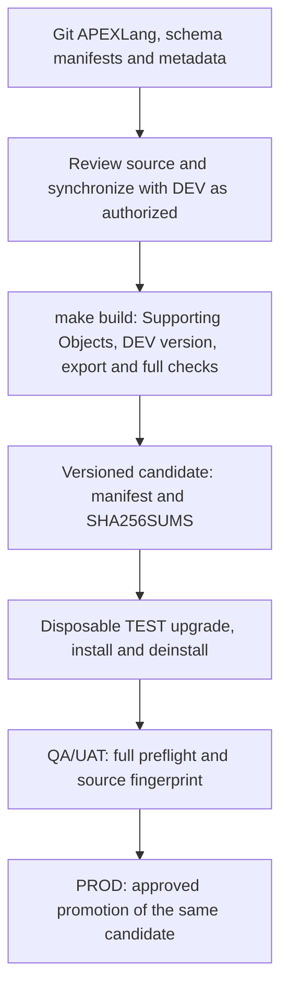

# Automation architecture

This describes the implemented automation, not a proposal for additional
environments. See [automation README](../README.md) for commands,
[environments](ENVIRONMENTS.md) for connection settings and the
[runbook](RUNBOOK.md) for operational procedures.

## Source and build ownership

| Source | Owner and purpose |
| --- | --- |
| `applications/blog-admin/`, `applications/blog/` | Git-tracked **APEXLang** sources, Supporting Objects and static assets |
| `Database/` | Git-tracked schema SQL; package specs and bodies are `.pks` / `.pkb` |
| `automation/schema/install.list`, `upgrade.list` | Explicit database object order; packages must have paired spec/body files |
| `Database/Tables/foreign_keys.sql`, `Database/Indexes/foreign_key_indexes.sql` | Authoritative constraints and FK index definitions |
| `applications/*/supporting-objects/install-scripts/metadata.sql` | Git-owned installation metadata; dynamic APEX application IDs must remain dynamic |
| `applications/blog-admin/supporting-objects/deinstall-script.sql` | **Manually maintained** deinstallation SQL |
| `VERSION.txt` | Release-version authority |
| `build/releases/<version>/` | Checksummed, protected SQL release candidate (not tracked in Git) |

`BUILD_API` is retired. `make supporting` assembles SQL from the repository
without SQLcl, renders the Public `G_APP_VERSION` and postupgrade version from
`VERSION.txt`, checks deinstall consistency and updates tracked Supporting
Objects SQL. It never generates deinstall SQL or reads metadata from DEV.
`Database/Views/BLOG_V_VERSION.sql` is included separately for Public.
Changes to generated files must be reviewed before release.

`make source` explicitly exports APEXLang from DEV, preserving Git-owned
Supporting Objects SQL and static files. `make build` reads DEV, verifies
strict release/source parity against Git, then exports **full application SQL
with Supporting Objects**. It does not change the tracked APEXLang. These are
separate modes of `automation/export_application.sh`; no combined default mode
exists.

## Normal release flow

The candidate contains Admin and Public full SQL exports, the application
release ZIP, the legacy stack ZIP, `README.md`, `LICENSE.txt`, `VERSION.txt`,
`manifest.json` and `SHA256SUMS`. The two ZIP names retain `-latest` inside a
**versioned directory**. Deployments consume the two checked/verified SQL
exports from the candidate; they do not re-export applications in QA or PROD.

**Release integrity:** the exporter sources
`automation/lib/candidate_publish.sh`; an exclusive `flock` is acquired before
DEV export. Publication stages and verifies a complete candidate on the same
filesystem. Replacing an eligible **unpromoted** local candidate requires
`OVERWRITE=YES`; the helper keeps backup/rollback state through final
verification. TEST/QA/PROD/verification take shared candidate locks. Lock files
live in `build/releases/.locks/`, are persistent and should **not** be deleted
manually. A failed interrupted replacement can retain `.backup.*` recovery
directories. See [safe candidate handling](RUNBOOK.md#candidate-integrity-and-overwrite).

`make build` assembles Git-owned Supporting Objects SQL, updates DEV versions,
exports both applications to temporary space and compares them with Git. Only
then does the exporter run the full `make check` gate (including all Python
tests), **before publication**. The build verifies the candidate and runs real
TEST acceptance; it fails if either gate fails. Stages remain sequential even
under parallel Make. It never runs `source` or `sync-dev` automatically, and
never silently resolves DEV/Git differences. Generated Supporting Objects may
change tracked SQL; check the diff.
`make verify-release` checks manifest and checksums. `make release-check`
combines strict source-version checks and artifact verification; it does **not**
check the candidate's source fingerprint against the current tree. The QA
promotion path **does** require that fingerprint match. PROD may promote an
older QA-tested candidate from `RELEASE_DIR` even if the working source has
moved forward, subject to approval and compatibility.

## Quality gates and tests

`make check` and GitHub Actions `make ci` run
`automation/ci/preflight.sh` in this order:

1. `make lint`: pre-commit static lint/format checks (no tests).
2. `make check-schema`: offline manifest, metadata and deinstall validation.
3. `make check-source`: work-in-progress-safe local APEXLang reference check.
4. `make test`: focused application-specific offline safety tests **once**.
5. `make validate`: SQLcl APEXLang validation **without a DB login**.

`make test-fast` runs schema, metadata and source-parity tests on demand; it is
not also run inside pre-commit. The selected workflow tests execute real
Bash/Make entry points using isolated files and a **mock SQLcl**. Generic CI
bootstrap and tool behavior is checked by actually running those tools, not by
Python mock regressions. These tests do not prove Oracle DDL, APEX installation
or PL/SQL compilation succeeds. See [offline safety tests](RUNBOOK.md#offline-safety-tests).
Real acceptance runs inside `make build` via `make test-release`, and can
also be repeated separately against an existing candidate in disposable TEST. It downloads the
latest published GitHub release unless `PREVIOUS_ZIP=path` is supplied, and
invokes upgrade, then fresh-install and deinstall checks;
individual TEST commands remain available. None runs in CI.

Direct `make sync-dev` and `make qa` enforce the full preflight before
database mutations. `make build` has its own strict source/version/parity
checks. Production promotion verifies its candidate and connected target;
it does **not** rerun the entire preflight. The emergency hotfix bypasses the
normal candidate, version, checksum and preflight gates altogether.

GitHub Actions runs the same quality gate on push and pull request, without
deployment secrets. It also validates the **unchanged legacy Terraform stack**
separately. Static checks include pre-commit, actionlint, ShellCheck, Ruff,
SQL hygiene, APEXLang validation and Terraform checks. See the actual
[CI workflow](../../.github/workflows/ci.yml) and
[pre-commit configuration](../../.pre-commit-config.yaml). The workflow
**does not** configure branch protection; repository administrators must
require the reported `quality` check in their branch rules/rulesets.

## Emergency hotfix boundary

`make hotfix-export` reads both QA/UAT applications into `build/hotfix/f<ID>.sql`
(Admin first), exporting Supporting Objects with them. A later
`make hotfix-production` imports **those saved SQL files** into
PROD without normal release checks or an automatic backup. The script also
verifies the configured PROD schema/workspace before either import. Supporting Objects install/
upgrade scripts run by default for both apps; `OBJECTS=NO` skips **automatic**
installation. The second import can fail after the first has already changed
PROD. See the [emergency runbook](RUNBOOK.md#emergency-hotfix).

**No staging target or automation is implemented.** Deployment code supports
QA and production; legacy `Stack/terraform` is not part of this refactor.
