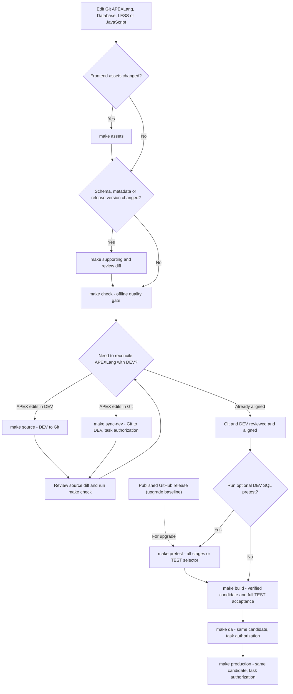
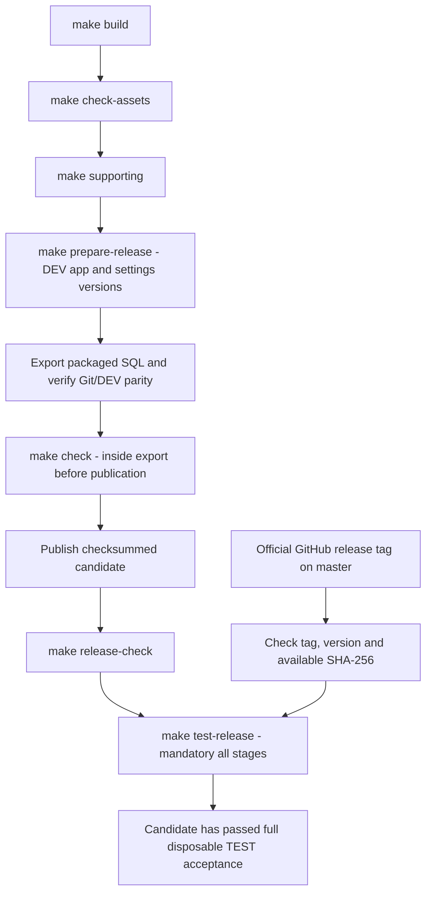

# Development flow

This is the **single guide to the order of development, verification, TEST and
release commands**. Run Make commands from the repository root. Only the
published targets and options are available through the
[MCP interface](MCP_AUTOMATION.md#published-mcp-tool-contract). The
[maintenance guide](MAINTENANCE.md) defines roles, task boundaries and
authorization; existing task authorization applies to the operations it
covers. See [environments](ENVIRONMENTS.md) for saved SQLcl connections. The
[runbook](RUNBOOK.md) covers operations, recovery and deployment precautions;
[architecture](ARCHITECTURE.md) explains the implementation.

## From source changes to promotion

For database-object changes, edit the Git-owned files in `Database/`, then apply
the SQL and compile PL/SQL in DEV under the task's authorization. This is a
separate step: `make supporting` generates local Supporting Objects SQL, and
`make sync-dev` imports APEX application definitions without installing those
Supporting Objects.

The APEXLang reconciliation branches below concern application definitions.



`make source` and `make sync-dev` run in **opposite directions**; choose only
one for a particular reconciliation and review changes. Neither runs
implicitly in `make build`. `make source` can overwrite local APEXLang files;
`make sync-dev` changes DEV and performs its own mandatory preflight.

`make supporting` generates Git-owned Supporting Objects SQL when database
schema, metadata or release-version inputs change; review its diff. Generate
before running `make check-schema` or `make check`, which require the current
Public metadata version. The build invokes generation again, but does not
import its outputs into DEV. Reconcile changed definitions before building.
`make assets` is required when editable LESS or JavaScript changes, and
`make check-assets` and `make check` verify the generated files are current.

## Prepare a release version

For a release-version change prepared in Git:

1. Set `VERSION.txt` and the `version:` field in both
   `applications/blog-admin/application.apx` and
   `applications/blog/application.apx` to the intended release. Leave
   historical upgrade conditions and version dates unchanged.
2. Run `make supporting` and review the generated SQL. Its exact inputs and
   outputs are listed in [architecture](ARCHITECTURE.md#source-and-build-ownership).
   Generate changed frontend assets before the quality gate as described above.
3. Apply relevant database SQL and compile PL/SQL in DEV separately. Under
   the task's authorization, use `make sync-dev` to import the reviewed
   APEXLang and generated Supporting Objects definitions. This command runs
   the full preflight, but does not execute Supporting Objects SQL.
4. Run `make build` for candidate creation and full TEST acceptance. Its
   `prepare-release` stage sets both DEV application versions and live
   `BLOG_SETTINGS.G_APP_VERSION` to `VERSION.txt`.

If optional pretest is needed **before** that build after a version change,
run `make prepare-release` under the same applicable DEV authorization after
reconciliation. Pretest requires DEV versions to be aligned already; it does
not prepare them. `prepare-release` does not update tracked APEXLang or import
generated SQL. Reconcile any DEV-authored application changes explicitly
before following the Git-to-DEV path above; neither direction runs automatically.

## Optional pretest from live DEV

`make pretest` automatically checks the configured DEV/TEST mappings and
requires both DEV application versions and live `BLOG_SETTINGS.G_APP_VERSION`
to match local `VERSION.txt`. These checks run before export for every test
selection. It then exports full packaged SQL with Supporting Objects for
**both** DEV applications into private temporary files and resets only the
dedicated disposable TEST environment. Nothing is published to
`build/releases/`, and exports are deleted on exit. It does **not**
check Git/DEV source parity or approve release promotion.

| Command | On disposable TEST | Result after success |
| --- | --- | --- |
| `make pretest` | Upgrade from previous release, fresh install, deinstall and verify empty | Empty |
| `make pretest TEST=upgrade` | Install previous release then upgrade to DEV SQL | Current DEV release installed |
| `make pretest TEST=install` | Reset then fresh-install DEV SQL | Current DEV release installed |
| `make pretest TEST=deinstall` | Reset, install DEV SQL, deinstall and verify empty | Empty |

**GitHub is the only previous-release source.** Upgrade stages resolve the
latest stable published GitHub Release of `jariolaine/apex-blog`, require its
tag's commit to be on `master`, and validate the attached
`apex-blog-latest.zip`. Any published SHA-256 digest (or the release's
`SHA256SUMS` asset) is checked. The `requireGithubReleaseSha256` setting in
`automation/variables.sh` defaults to `NO` for historical releases without a
published checksum; set it to `YES` when checksum availability must be enforced.
A missing checksum in `NO` mode produces a warning, not independent integrity
verification. This is not a Make or MCP command parameter.
The release tag identifies its application version; an embedded `VERSION.txt`
must agree, while historical release ZIPs without one use the verified tag.
The baseline is checked **before any TEST reset**. `TEST=install` and
`TEST=deinstall` do not contact GitHub. Temporary exports and downloads are
removed on exit. There is no `PREVIOUS_ZIP` or arbitrary download-URL override.

For **APEX runtime changes**, pretest permits the official GitHub release to
have the **same application version** as DEV. The TEST database must already
run the APEX version being tested: pretest does not upgrade the runtime.

MCP exposes exactly the same supported selection without enabling arbitrary
Make variables:

```text
automation_start(target="pretest")
automation_start(target="pretest", test="upgrade")
```

These are server tool names; clients may add a namespace as described in the
[MCP guide](MCP_AUTOMATION.md#published-mcp-tool-contract).

The `test` option accepts only `install`, `upgrade`, or `deinstall` and is
rejected for every other MCP target. Neither MCP nor direct Make accepts
local previous-release ZIP paths; both use the same verified GitHub baseline.
TEST resets are preauthorized under the
[environment policy](MAINTENANCE.md#application-data-and-environment-policy).

## Formal candidate build and release acceptance

The **only standard release candidate creation command** is `make build`.
It uses the task's authorization for DEV version changes. Follow
[release-version preparation](#prepare-a-release-version) before building.
The command publishes a versioned candidate after its source and offline gates
pass, then runs release verification and full TEST acceptance. A published
local candidate can therefore remain after a failed TEST stage. Stages run
sequentially, including when Make is invoked with `-j`:



If TEST fails because of an environment or transient problem, correct that
problem and run `make test-release` against **the same** candidate. If the
packaged application or schema SQL is defective, correct and reconcile the
source, then build a corrected candidate under the
[overwrite/version procedure](RUNBOOK.md#candidate-integrity-and-overwrite).
Changing working-tree source does not change an existing candidate.

`make test-release` always runs upgrade, fresh installation and verified
deinstall; it cannot select a single stage. It requires a **strictly older**
previous release from an official GitHub tag on `master`. Missing releases,
invalid tag ancestry or version, and mismatches against published checksums
fail before TEST is cleared. The checksum-availability policy above still
applies. `RELEASE_DIR=path` selects an existing candidate for release-checking,
TEST acceptance or promotion. This option and `OVERWRITE=YES` are Make options,
not MCP parameters. Never overwrite an approved or published release.

The candidate includes packaged SQL and checksums. `make qa` and
`make production` promote that **same candidate**, not fresh DEV exports.
The emergency hotfix flow is deliberately separate: see
[hotfix instructions](RUNBOOK.md#emergency-hotfix).

## Command selection and boundaries

| Intent | Command | Execution notes |
| --- | --- | --- |
| Generate frontend application files | `make assets` | Writes tracked generated CSS/JS; plugin assets excluded |
| Generate Supporting Objects SQL | `make supporting` | Writes tracked SQL from Git |
| Run application tests | `make test` | Excludes infrastructure-maintainer tests |
| Check generated files | `make check-assets` | Read-only |
| Run full offline gate | `make check` | Includes lint, schema/source, assets, application tests and APEXLang validation |
| Validate locally | `make validate`, `make check-schema`, `make check-source` | Selective checks only; no DB changes |
| Test live DEV on TEST | `make pretest [TEST=install|upgrade|deinstall]` | Optional subset; temporary SQL only |
| Test existing candidate | `make test-release` | Mandatory full acceptance, no test selector |
| Build candidate | `make build` | Includes TEST acceptance and DEV changes |
| Check existing candidate | `make release-check` | No rebuild |
| Promote | `make qa`, then `make production` | Same release candidate; task authorization must cover the target environment |

The everyday `make help` intentionally omits low-level implementation
commands such as `prepare-release`, `check-release` and `verify-release`.
Automation-maintainer tests (`automation/tests/`, `automation/mcp/tests/`)
are invoked separately and are **not** part of `make test`, `make check`,
MCP application jobs or the standard build. See the
[maintainer test instructions](RUNBOOK.md#automation-maintainer-regression-tests).
