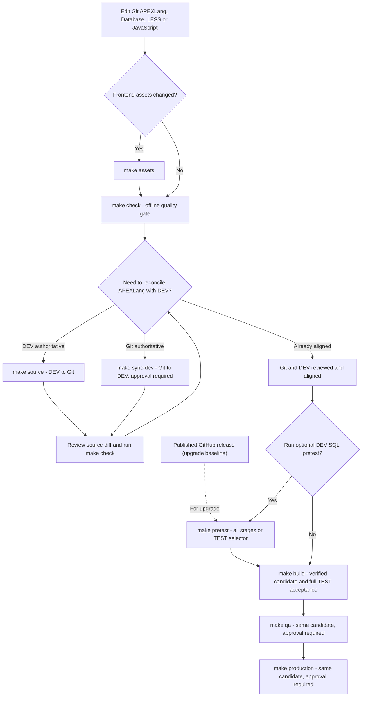

# Development flow

This is the **single guide to the order of development, verification, TEST and
release commands**. All commands run from the repository root or through the
supported [MCP interface](MCP_AUTOMATION.md#published-mcp-tool-contract). Consult
[AGENTS.md](../../AGENTS.md) for authorization and
[environments](ENVIRONMENTS.md) for saved SQLcl connections. The
[runbook](RUNBOOK.md) covers operations, recovery and deployment precautions;
[architecture](ARCHITECTURE.md) explains the implementation.

## From source changes to promotion



`make source` and `make sync-dev` run in **opposite directions**; choose only
one for a particular reconciliation and review changes. Neither runs
implicitly in `make build`. `make source` can overwrite local APEXLang files;
`make sync-dev` changes DEV and performs its own mandatory preflight.

`make supporting` generates Git-owned Supporting Objects SQL when database
schema/metadata changes; review its diff. It is also invoked by `make build`,
so it is not an extra mandatory command immediately before every build.
`make assets` is required when editable LESS or JavaScript changes, and
`make check-assets` and `make check` verify the generated files are current.

## Optional pretest from live DEV

`make pretest` exports full packaged SQL with Supporting Objects for **both**
DEV applications into private temporary files, checks DEV/TEST identities,
then resets only the dedicated disposable TEST environment. Nothing is
published to `build/releases/`, and exports are deleted on exit. It does **not**
check Git/DEV source parity or approve release promotion.

| Command | On disposable TEST | Result after success |
| --- | --- | --- |
| `make pretest` | Upgrade from previous release, fresh install, deinstall and verify empty | Empty |
| `make pretest TEST=upgrade` | Install previous release then upgrade to DEV SQL | Current DEV release installed |
| `make pretest TEST=install` | Reset then fresh-install DEV SQL | Current DEV release installed |
| `make pretest TEST=deinstall` | Reset, install DEV SQL, deinstall and verify empty | Empty |

**GitHub is the only previous-release source.** Upgrade stages resolve the
latest stable published GitHub Release of `jariolaine/apex-blog`, require its
tag's commit to be on `master`, and validate the attached
`apex-blog-latest.zip`. Any published SHA-256 digest (or the release's
`SHA256SUMS` asset) is checked. The `requireGithubReleaseSha256` setting in
`automation/variables.sh` defaults to `NO` for historical releases without a
published checksum; set it to `YES` when checksum availability must be enforced.
A missing checksum in `NO` mode produces a warning, not independent integrity
verification. This is not a Make or MCP command parameter.
The release tag identifies its application version; an embedded `VERSION.txt`
must agree, while historical release ZIPs without one use the verified tag.
The baseline is checked **before any TEST reset**. `TEST=install` and
`TEST=deinstall` do not contact GitHub. Temporary exports and downloads are
removed on exit. There is no `PREVIOUS_ZIP` or arbitrary download-URL override.

For **APEX runtime changes**, pretest permits the official GitHub release to
have the **same application version** as DEV. The TEST database must already
run the APEX version being tested: pretest does not upgrade the runtime.

MCP exposes exactly the same supported selection without enabling arbitrary
Make variables:

```text
apex_blog__automation_start(target="pretest")
apex_blog__automation_start(target="pretest", test="upgrade")
```

The `test` option accepts only `install`, `upgrade`, or `deinstall` and is
rejected for every other MCP target. Neither MCP nor direct Make accepts
local previous-release ZIP paths; both use the same verified GitHub baseline.
TEST resets are preauthorized; DEV/QA/PROD changes are not.

## Formal candidate build and release acceptance

The **only standard release candidate creation command** is `make build`.
It requires authorization to update DEV application versions and publishes a
versioned candidate only after its checks pass. It runs the following stages
sequentially, including when Make is invoked with `-j`:


If an unapproved candidate was already published but TEST acceptance failed,
fix the cause and run `make test-release` to retest **the same** candidate.
That command always runs upgrade, fresh installation and verified deinstall;
it cannot select a single stage. It requires a **strictly older** previous
release from verified GitHub tags on `master`; the prior release must be
**strictly older** than the candidate. Missing, tampered or non-ancestral
GitHub releases fail before TEST is cleared. `RELEASE_DIR=path` selects an existing candidate for release-checking, TEST
acceptance or promotion. `OVERWRITE=YES` is allowed only for an eligible
unpromoted local candidate; never overwrite an approved or published release.

The candidate includes packaged SQL and checksums. `make qa` and
`make production` promote that **same candidate**, not fresh DEV exports.
The emergency hotfix flow is deliberately separate: see
[hotfix instructions](RUNBOOK.md#emergency-hotfix).

## Command selection and boundaries

| Intent | Command | Execution notes |
| --- | --- | --- |
| Generate frontend application files | `make assets` | Writes tracked generated CSS/JS; plugin assets excluded |
| Generate Supporting Objects SQL | `make supporting` | Writes tracked SQL from Git |
| Run application tests | `make test` | Excludes infrastructure-maintainer tests |
| Check generated files | `make check-assets` | Read-only |
| Run full offline gate | `make check` | Includes lint, schema/source, assets, application tests and APEXLang validation |
| Validate locally | `make validate`, `make check-schema`, `make check-source` | Selective checks only; no DB changes |
| Test live DEV on TEST | `make pretest [TEST=install|upgrade|deinstall]` | Optional subset; temporary SQL only |
| Test existing candidate | `make test-release` | Mandatory full acceptance, no test selector |
| Build candidate | `make build` | Includes TEST acceptance and DEV changes |
| Check existing candidate | `make release-check` | No rebuild |
| Promote | `make qa`, then `make production` | Same release candidate; separate approvals |

The everyday `make help` intentionally omits low-level implementation
commands such as `prepare-release`, `check-release` and `verify-release`.
Automation-maintainer tests (`automation/tests/`, `automation/mcp/tests/`)
are invoked separately and are **not** part of `make test`, `make check`,
MCP application jobs or the standard build. See the
[maintainer test instructions](RUNBOOK.md#automation-maintainer-regression-tests).
